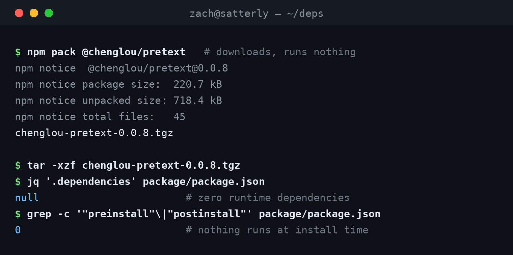

# Done isn't safe

Fireship put two videos in my feed the same week: [a delightful new text-measurement library](https://www.youtube.com/watch?v=vd14EElCRvs) and [a single PR hijacking the npm registry](https://www.youtube.com/watch?v=gwTQLZSIlsU). I pointed my agents at the fun one. This post is about what happened when I went back and watched the other one.

<!-- more -->

The premise of this series, stated once so the posts don't have to keep explaining themselves: agents can ship working software in an afternoon, and nothing in their loop asks whether it's safe. I guide the builds and help develop. Security is a shared responsibility, and the ultimate owner is me. Each post is one build, one audit, and the gap between them, closed in public.

## The build

[nagops.com](https://nagops.com) is a satirical project-management nag: a keyword field of workplace dread ("story points are astrology for engineers"), a sprint clock that never stops, UFOs that abduct your backlog. Agents built it. Vite, TypeScript, and one runtime dependency: [pretext](https://github.com/chenglou/pretext), Cheng Lou's text measurement engine. Pretext measures every keyword once; after that, physics, hit-testing, and scoring are arithmetic on cached widths. It's a great library doing a small job well.


That's the first video's contribution. Now the second one.

## The threat

On May 11, 2026, an attacker published 84 malicious versions across 42 TanStack Router/Start packages in about six minutes. By May 12, Aikido counted 373 malicious package-version entries across 169 npm package names, and the campaign kept going.

No password was cracked. The chain, per TanStack's postmortem:

1. A `pull_request_target` workflow checked out and ran fork-controlled code. Privileged context, untrusted input.
2. That code poisoned a build cache shared with the release path, then the attacker restored the PR to a no-op and closed it. It sat open roughly 42 minutes.
3. The release runner restored the poisoned cache.
4. The payload read a short-lived GitHub Actions OIDC credential out of runner memory.
5. npm's trusted publishing accepted a credential from the authorized workflow, and shipped malware.

The release path was authenticated the whole time. The inputs behind it were already rotten. Signatures answer "did the right pipeline publish this?", not "was the pipeline's lunch poisoned?"

One more detail. The malicious commits were authored as `claude <claude@users.noreply.github.com>`. Fabricated identity, not the real Anthropic tooling. The attacker knew nobody looks twice at an AI's name in a commit log anymore. Sit with that.

## The audit

The video ends with four concrete protections: pnpm 11, a minimum release age, blocking exotic subdependencies, and approved-builds for install scripts.

Out of the box, my agents had implemented none of them.

Not a complaint. A finding. And worth being specific about who "the agents" are: nagops.com was built with Claude Opus 4.8. The output is genuinely clean. I pulled the live 67 KB bundle and read it:

- **Sinks:** zero `eval`, `new Function`, `document.write`, `atob`. One `innerHTML` write, a static string literal with no interpolation. Not a sink.
- **Network:** one `fetch`, framework-internal; no external host appears anywhere in the bundle. The `mousemove` handlers are the "move your mouse" gag, not tracking.
- **Input surface:** none. No forms, no prompts, no contenteditable, no clipboard access.

Clean code. Now here is everything the same model didn't do until I explicitly went looking, by layer:

| Layer | Missing until asked |
|---|---|
| Response headers | CSP, HSTS, X-Frame-Options / frame-ancestors, Permissions-Policy |
| Disclosure | a real `/.well-known/security.txt` (the SPA catch-all faked a 200 for the path) |
| Install policy | scripts ran by default; no release-age gate; subdeps could resolve from any git repo or tarball; no publisher-trust policy |
| Toolchain | floating `^` ranges on build-critical deps; Node version unpinned |
| Third parties | Google Fonts in the head (every visitor hands Google their IP for two font files); analytics beacon on by default |
| Domain | DNSSEC off; no SPF `-all` / DMARC `p=reject` on a domain that will never send mail |
| Pipeline | push straight to production, no review gate; for a while the deployed site's source wasn't in any repo at all |

Sixteen controls. Zero were present, and zero were refused. Opus never said no. I never asked.

That's the real lesson, and it's not a Claude problem: a frontier model will ship you a clean-coded, insecure product without blinking, because "secure" was never in the acceptance criteria. Nobody ships an insecure product on purpose. You ship it by not asking.

Agents optimize for "is it done yet?" No agent in the loop was inherently asking "is it safe yet?" That question doesn't come from the build loop. It gets brought in from outside, and it's mine to bring.

One more distinction the table hides: headers protect the visitor, install policy protects the build machine. The TanStack vector never touches a visitor; it executes at install time. Harden one and ignore the other and you have a security page that protects nobody.

## The fix

The nagops repo now runs pnpm 11. The entire config fits on a screen:

```yaml
# pnpm-workspace.yaml
minimumReleaseAge: 4320    # nothing published in the last 3 days gets installed
blockExoticSubdeps: true   # transitive deps can't come from git repos or tarball URLs
trustPolicy: no-downgrade  # refuse packages whose publisher trust dropped
```

What each line buys, against the incident above:

- **`minimumReleaseAge`**: the malicious TanStack versions lived hours. A three-day quarantine means my install never even sees a release that young. pnpm 11 defaults this to one day, but the default is non-strict and can fall back. Set it explicitly if you want it enforced.
- **`blockExoticSubdeps`**: no dependency of a dependency can quietly resolve from someone's git branch.
- **`trustPolicy: no-downgrade`**: a package that was publishing with provenance and suddenly isn't is exactly what a hijacked account looks like. Refuse it.
- **Install scripts**: dead by default since pnpm 10. A postinstall payload never runs. Anything that legitimately needs to build goes through `pnpm approve-builds`, by hand, on purpose. This project's allowlist is empty; Vite 8 ships prebuilt binaries.

And the one runtime dependency got the manual treatment before it was ever installed: `npm pack`, then read the tarball like it owes you money.



Zero dependencies, zero install hooks, thirty seconds of reading. Pretext was never implicated in the TanStack campaign. The point is I can say that from the tarball, not from vibes.

## What's still open

Most of the table. The headers and the real security.txt are staged and ship with the next deploy. The fonts get self-hosted so the page phones exactly no one. DNSSEC and the no-mail DNS records are one-time dashboard work. The pipeline review gate is getting its own post, because the current failure mode (a bad push auto-deploys to production) deserves a writeup, not a quiet fix. For the scoreboard crowd: securityheaders.com currently grades the live site a D. Fair.

The scoreboard on nagops.com counts story points. The supply chain doesn't award any for installing fast.

---

*Sources: [TanStack postmortem](https://tanstack.com/blog/npm-supply-chain-compromise-postmortem) · [TanStack advisory](https://github.com/TanStack/router/security/advisories/GHSA-g7cv-rxg3-hmpx) · [Aikido campaign report](https://www.aikido.dev/blog/mini-shai-hulud-is-back-tanstack-compromised) · [pnpm supply-chain docs](https://pnpm.io/supply-chain-security) · [GitHub: untrusted code checkout](https://docs.github.com/en/actions/reference/security/secure-use#mitigating-the-risks-of-untrusted-code-checkout)*
