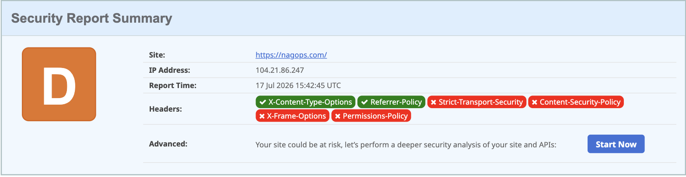

# Done isn't safe

Fireship put two videos in my feed the same week: [a delightful new text-measurement library](https://www.youtube.com/watch?v=vd14EElCRvs) and [a single PR hijacking the npm registry](https://www.youtube.com/watch?v=gwTQLZSIlsU). I pointed my agents at the fun one. This post is about what happened when I went back and watched the other one.

<!-- more -->

## The build

[nagops.com](https://nagops.com) is a satirical project-management nag: a keyword field of workplace dread ("story points are astrology for engineers"), a sprint clock that never stops, UFOs that abduct your backlog. Agents built it. Vite, TypeScript, and one runtime dependency: [pretext](https://github.com/chenglou/pretext), Cheng Lou's text measurement engine. Pretext measures every keyword once; after that, physics, hit-testing, and scoring are arithmetic on cached widths. It's a great library doing a small job well.


That's the first video's contribution. Now the second one.

## The threat

On May 11, 2026, an attacker published 84 malicious versions across 42 TanStack Router/Start packages in about six minutes. By May 12, Aikido counted 373 malicious package-version entries across 169 npm package names, and the campaign kept going.

No password was cracked. The chain, per TanStack's postmortem:

1. A `pull_request_target` workflow checked out and ran fork-controlled code. Privileged context, untrusted input.
2. That code poisoned a build cache shared with the release path, then the attacker restored the PR to a no-op and closed it. It sat open roughly 42 minutes.
3. The release runner restored the poisoned cache.
4. The payload read a short-lived GitHub Actions OIDC credential out of runner memory.
5. npm's trusted publishing accepted a credential from the authorized workflow, and shipped malware.

The release path was authenticated the whole time. The inputs behind it were already rotten. Signatures answer "did the right pipeline publish this?" — not "was the pipeline's lunch poisoned?"

One more detail. The malicious commits were authored as `claude <claude@users.noreply.github.com>`. Fabricated identity, not the real Anthropic tooling. The attacker knew nobody looks twice at an AI's name in a commit log anymore. Sit with that.

## The audit

The video ends with four concrete protections: pnpm 11, a minimum release age, blocking exotic subdependencies, and approved-builds for install scripts.

Out of the box, my agents had implemented none of them.

Not a complaint. A finding. The agents shipped exactly what I asked for: a working site, fast. What they defaulted to was npm with stock settings (no release-age gate exists there at all), install scripts enabled, Google Fonts called from the page head, no CSP, no HSTS, and a security.txt that was actually the SPA's catch-all faking a 200. Here's what securityheaders.com thought of it:



Agents optimize for "is it done yet?" Nobody in the loop was asking "is it safe yet?" That's the actual division of labor: they build, I secure. Which is the whole premise of this series.

## The fix

The nagops repo now runs pnpm 11. The entire config fits on a screen:

```yaml
# pnpm-workspace.yaml
minimumReleaseAge: 4320    # nothing published in the last 3 days gets installed
blockExoticSubdeps: true   # transitive deps can't come from git repos or tarball URLs
trustPolicy: no-downgrade  # refuse packages whose publisher trust dropped
```

What each line buys, against the incident above:

- **`minimumReleaseAge`**: the malicious TanStack versions lived hours. A three-day quarantine means my install never even sees a release that young. pnpm 11 defaults this to one day, but the default is non-strict and can fall back — set it explicitly if you want it enforced.
- **`blockExoticSubdeps`**: no dependency of a dependency can quietly resolve from someone's git branch.
- **`trustPolicy: no-downgrade`**: a package that was publishing with provenance and suddenly isn't is exactly what a hijacked account looks like. Refuse it.
- **Install scripts**: dead by default since pnpm 10. A postinstall payload never runs. Anything that legitimately needs to build goes through `pnpm approve-builds`, by hand, on purpose. This project's allowlist is empty; Vite 8 ships prebuilt binaries.

And the one runtime dependency got the manual treatment before it was ever installed: `npm pack`, then read the tarball like it owes you money.


Zero dependencies, zero install hooks, thirty seconds of reading. Pretext was never implicated in the TanStack campaign — the point is I can say that from the tarball, not from vibes.

## What's still open

The D grade. The hardening files are staged (strict CSP, HSTS, a real security.txt), and the Google Fonts call is getting replaced with self-hosted files so the deployed page phones exactly no one. That's the next post: taking a site agents built from D to A without breaking the gag.

The scoreboard on nagops.com counts story points. The supply chain doesn't award any for installing fast.

---

*Sources: [TanStack postmortem](https://tanstack.com/blog/npm-supply-chain-compromise-postmortem) · [TanStack advisory](https://github.com/TanStack/router/security/advisories/GHSA-g7cv-rxg3-hmpx) · [Aikido campaign report](https://www.aikido.dev/blog/mini-shai-hulud-is-back-tanstack-compromised) · [pnpm supply-chain docs](https://pnpm.io/supply-chain-security) · [GitHub: untrusted code checkout](https://docs.github.com/en/actions/reference/security/secure-use#mitigating-the-risks-of-untrusted-code-checkout)*
