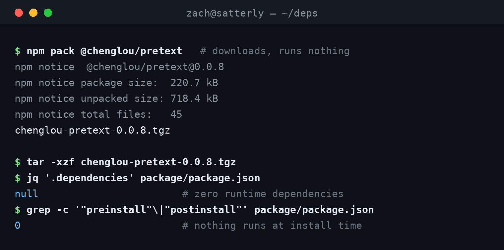
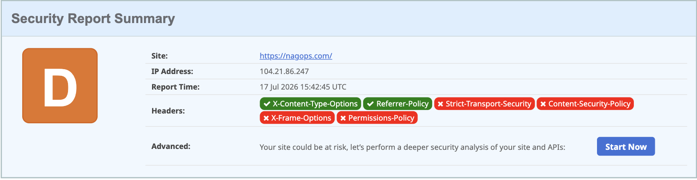

# Typewriters and trojans

Fireship, one of my favorite private equity backed Youtube technology channels, posted about [an awesome new npm library](https://www.youtube.com/watch?v=vd14EElCRvs) and [a RAT hiding in one of the most installed libraries on earth](https://www.youtube.com/watch?v=o7NYXvYohYk) in the same feed, around the same time. 

If I find something interesting in the code report, often times i'll go to one of my trusty agents to learn, build and, eventually, secure. One of the best things about AI these days is you can wear many hats, and since I work in security, I can do some full stack engineering, but keep sharpening my security toolkit by securing the thing. Cue [nagops.com](https://www.nagops.com).

<!-- more -->

The [pretext](https://github.com/chenglou/pretext) module - tldr; Pretext is a text measurement engine. Normally when you ask "how tall is this paragraph?", the browser has to stop and think about it, and asking a lot makes pages janky. pretext measures each character once, and after that every answer is just math. How fast is just math? Fast enough that someone built [a full Breakout clone on it](https://pretextjs.dev/pretext-breaker) where the bricks are words, the ball smashes through sentences, and the background text flows around everything at 60fps.

The [axios](https://www.stepsecurity.io/blog/axios-compromised-on-npm-malicious-versions-drop-remote-access-trojan) story - tldr; an attacker hijacked a maintainer's npm account and shipped two poisoned versions of a library with 100 million weekly downloads. The whole payload was one new dependency, `plain-crypto-js`, a typosquat of crypto-js. It doesn't need importing. Its postinstall script runs at install time and drops a cross-platform RAT that vacuums up SSH keys, cloud tokens, and credentials. It was live for about three hours, which was still long enough for [Backstage's CI to catch it executing](https://securitylabs.datadoghq.com/articles/axios-npm-supply-chain-compromise/) in production pipelines.

The lesson fits in one sentence: `npm install` is arbitrary code execution, and the code isn't always the library.

So how do you install a dependency the same month axios grew a RAT? Slowly, and on purpose.

`npm pack` downloads the package without running a single line of its code. Then you read package.json like it owes you money:



Zero dependencies, nothing that runs at install time, thirty seconds of reading. That same check catches the axios payload, because a crypto library materializing in a patch release of an HTTP client is not subtle.

Then I vendored it. pretext 0.0.8 lives in this site's repo, license included, and the deployed page makes zero requests to CDNs or registries. (nagops.com consumes it the other way — an npm dependency locked by package-lock.json and bundled at build time, so the deployed page doesn't phone home either.) A hijacked maintainer account can't reach a site that never phones home. Updates happen when I pack the new version, diff it, and commit it on purpose. The axios window was three hours; deliberate updates don't race three-hour windows.

The cost, stated plainly: no advisory feed watches my vendor folder. Noticing is my job now. For one dependency-free library on a one-page site, easy trade. At work scale I'd argue the other side.

And the other side has tooling now, because Fireship [covered that too](https://www.youtube.com/watch?v=gwTQLZSIlsU) after a worm chewed through TanStack this May. The short version: use pnpm 11 and let someone else's code be paranoid for you.

```yaml
# pnpm-workspace.yaml
minimumReleaseAge: 4320   # ignore anything published in the last 3 days
blockExoticSubdeps: true  # sub-dependencies can't come from random git repos or tarball URLs
trustPolicy: no-downgrade # if a package's publisher trust drops, don't install it
```

Install scripts have been dead by default since pnpm 10, so a `plain-crypto-js` never gets to run its payload; anything that legitimately needs to build gets added to [allowBuilds](https://pnpm.io/supply-chain-security) by hand, on purpose. And the release-age delay is the quiet killer: the axios versions lived three hours, malware rarely survives a day, and pnpm 11 now waits a full day by default before it will even look at a new release. Most supply chain attacks die in the waiting room.

One boundary worth keeping sharp: the axios RAT attacked developers, not users. Install discipline protects me. Headers protect visitors. Confusing the two is how sites end up with a security page that protects nobody.

---

This is the first post in **build it & secure it**: agents build something real, I secure it and learn from it. The something real is [nagops.com](https://nagops.com), and here's what it scores on [securityheaders.com](https://securityheaders.com) today:



A D. The agents shipped features; nobody shipped headers. That's the next post.
